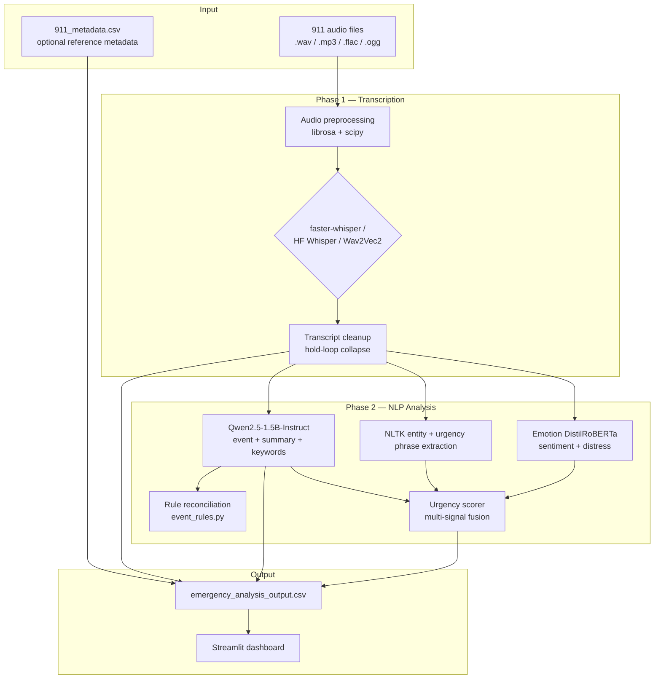
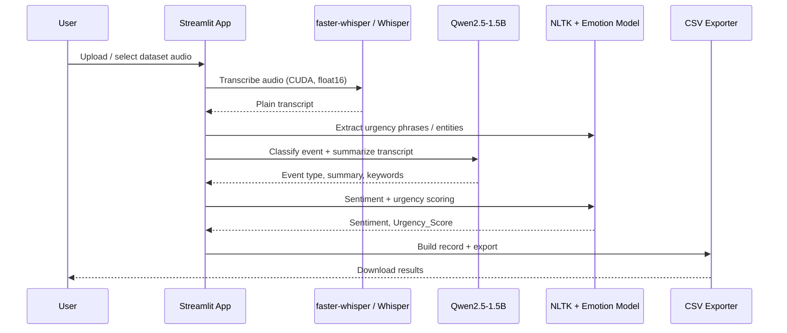

# Audio Analyst

**Audio Analyst** is a Streamlit application that converts real-world 911 emergency audio into structured intelligence. It transcribes calls, classifies incident types, generates summaries, scores urgency and sentiment, and exports everything to CSV for analysis.

Built for large, noisy, real dispatch audio — not clean lab speech.

---

## Features

- **Multi-engine speech-to-text**
  - `faster-whisper` (recommended for speed)
  - HuggingFace Whisper
  - Wav2Vec2 960h (optional, faster but less reliable on 911 audio)
- **Whisper model tiers**
  - Fast / Moderate / Slow
  - **Large v3 Turbo**
  - **Distil Large v3**
- **GPU optimizations**
  - CUDA support
  - Optional **float16** precision for Whisper-family models
  - Large batch mode (transcribe first, then LLM — better for 6 GB GPUs)
- **LLM-powered analysis** with **Qwen2.5-1.5B-Instruct**
  - Event type classification
  - Transcript summary
  - Location/person mentions
  - Emergency keywords
- **Hybrid event reconciliation**
  - LLM output + rule-based hints from transcript patterns
- **Robust urgency scoring**
  - Combines transcript, LLM summary, LLM event type, and emotion signals
- **Sentiment analysis** with emotion DistilRoBERTa
- **Batch processing at scale**
  - Checkpoint/resume via `outputs/.batch/`
  - Progress bar with ETA
- **CSV export** with downloadable results from the UI
- **Portable Hugging Face cache**
  - Auto-uses `./hf_cache` to avoid common Windows permission issues

---

## How It Works

### High-level pipeline



### Per-file processing stages



### Technology stack

| Layer | Tool / Library | Role |
|------|----------------|------|
| UI | [Streamlit](https://streamlit.io/) | Web interface, batch controls, CSV download |
| ASR (fast) | [faster-whisper](https://github.com/SYSTRAN/faster-whisper) | Optimized Whisper inference (CTranslate2) |
| ASR (standard) | [Transformers](https://huggingface.co/docs/transformers) + Whisper | HuggingFace Whisper pipeline |
| ASR (alt) | Wav2Vec2 960h | Faster CTC baseline (not recommended for final 911 transcripts) |
| Audio I/O | librosa, soundfile, scipy | Load, denoise, filter, normalize audio |
| LLM | [Qwen2.5-1.5B-Instruct](https://huggingface.co/Qwen/Qwen2.5-1.5B-Instruct) | Event classification + structured summary |
| NLP rules | NLTK + custom `event_rules.py` | Phrase rules, metadata-informed hints, reconciliation |
| Sentiment | [emotion-english-distilroberta-base](https://huggingface.co/j-hartmann/emotion-english-distilroberta-base) | Emotion labels + distress signal |
| Data | pandas | CSV assembly and export |
| Runtime | PyTorch + torchaudio | GPU/CPU execution |
| Cache | `./hf_cache` (auto) | Local Hugging Face model cache |

---

## Dataset

Audio and metadata come from the public 911 dispatch corpus used in this Kaggle notebook:

**[911 Calls — Wav2Vec2 (Kaggle)](https://www.kaggle.com/code/stpeteishii/911-calls-wav2vec2s)**

The project uses:

- `dataset/*.mp3` (and other supported audio formats)
- `dataset/911_metadata.csv` with fields such as:
  - `title`, `description`, `state`, `date`
  - casualty / false-alarm flags
  - original archive audio links

Metadata is used for:

- `Date_Time` and `Location` columns in CSV output
- optional LLM classification hints when transcript quality is reliable

Metadata is **not** used as the sole source for summaries when transcript quality is poor.

---

## Score Calculations

### 1) Urgency Score (`Urgency_Score`, 0.0–1.0)

Urgency is computed from **transcript + LLM summary + LLM event type** (not metadata alone):

```text
urgency_score =
    0.30 * event_type_baseline
  + 0.22 * transcript_phrase_urgency
  + 0.18 * summary_phrase_urgency
  + 0.10 * llm_keyword_urgency
  + 0.10 * emotional_distress
  + 0.10 * negation_boost
```

Additional logic:

- **Critical event floor** for life-threatening types (Shooting, Medical emergency, etc.)
- **False alarm cap** to prevent inflated urgency
- **Negation boost** for phrases like `not breathing`, `can't move`, `unable to breathe`

Interpretation:

| Range | Level |
|------|-------|
| 0.0 – 0.3 | Low |
| 0.3 – 0.6 | Moderate |
| 0.6 – 0.8 | High |
| 0.8 – 1.0 | Critical |

### 2) Confidence Score (`Confidence_Score`, 0.0–1.0)

Final confidence is the average of three components:

```text
confidence_score = average(
    transcription_confidence,
    sentiment_confidence,
    llm_confidence
)
```

Where:

- **Transcription confidence** blends audio quality + transcript quality heuristics
- **Sentiment confidence** comes from the top emotion-model probability
- **LLM confidence** reflects event reconciliation certainty

Failed transcription rows get `Confidence_Score = 0.0`.

### 3) Sentiment labels

From emotion model + urgency context:

- `Fearful`, `Angry`, `Sad`, `Surprised`, `Calm`, `Neutral`, `Disgusted`
- `Critical Distress` when urgency is high and emotion is strongly negative

---

## How to Use

### 1) Install dependencies

**Windows (PowerShell):**

```powershell
cd "Audio Analyst"
python -m venv .venv
.\.venv\Scripts\Activate.ps1
pip install torch==2.4.1 torchaudio==2.4.1 --index-url https://download.pytorch.org/whl/cu121
pip install -r requirements.txt
```

**Linux / macOS:**

```bash
python3 -m venv .venv
source .venv/bin/activate
pip install torch==2.4.1 torchaudio==2.4.1
pip install -r requirements.txt
```

### 2) Add data

Place audio in `dataset/` (or upload in UI).  
Optional: include `dataset/911_metadata.csv`.

### 3) Run app

```bash
streamlit run app.py
```

The app automatically uses `./hf_cache` for model downloads unless `HF_HOME` is already set.

### 4) Recommended settings (large batches)

For 700+ files on a 6 GB GPU:

- Engine: **faster-whisper**
- Model tier: **Distil Large v3**
- Precision: **float16 (CUDA)**
- Device: **GPU (CUDA)**
- **Large batch mode**: ON
- **Resume from checkpoint**: ON

Then click **Process Files**.

### 5) Output

- UI table + per-call details
- CSV: `outputs/emergency_analysis_output.csv`
- Checkpoint cache: `outputs/.batch/`

---

## Requirements

- Python **3.10+** (3.11 recommended)
- **8+ GB RAM** (32 GB recommended for large batches)
- NVIDIA GPU with CUDA (recommended; CPU works but much slower)
- ~10–15 GB free disk for model cache and outputs
- Internet on first run (model download)

Core packages (`requirements.txt`):

- `streamlit`, `pandas`, `numpy`
- `torch`, `torchaudio`
- `transformers`, `accelerate`, `sentencepiece`
- `faster-whisper`
- `librosa`, `scipy`, `soundfile`
- `nltk`

---

## Benchmark Run (Author Configuration)

Processed on local hardware:

| Setting | Value |
|--------|-------|
| Files processed | **707** |
| Runtime | **~4 hours** |
| ASR engine | `faster-whisper` |
| Model | **Distil Large v3** |
| Precision | **float16** |
| Device | CUDA |
| LLM | Qwen2.5-1.5B-Instruct |
| Batch mode | Large batch + checkpoint resume |
| Hardware | 32 GB RAM, NVIDIA Quadro RTX 3000 (6 GB VRAM) |

Approximate throughput: **~177 files/hour** (~20 seconds/file average, including LLM + sentiment stages).

---

## Results Report (`outputs/emergency_analysis_output.csv`)

Statistics from the full processed batch:

### Coverage

| Metric | Value |
|--------|------:|
| Total processed rows | 707 |
| Transcription failures | 6 |
| Location known | 699 (98.9%) |
| Location unknown | 8 |
| Date/Time known | 687 (97.2%) |
| Date/Time unknown | 20 |

### Event type distribution (top 15)

| Event Type | Count |
|------------|------:|
| Shooting | 136 |
| Murder | 130 |
| Medical emergency | 103 |
| False alarm | 43 |
| Burglary | 36 |
| Kidnapping | 25 |
| Robbery | 24 |
| Drowning | 23 |
| Fire | 22 |
| Public safety incident | 22 |
| Vehicle collision | 22 |
| Stabbing | 18 |
| Vehicle chase | 14 |
| Plane crash | 13 |
| Suicide | 11 |

Total distinct event labels detected: **39**.

### Sentiment distribution

| Sentiment | Count |
|-----------|------:|
| Critical Distress | 262 |
| Fearful | 171 |
| Neutral | 133 |
| Surprised | 91 |
| Sad | 25 |
| Angry | 20 |
| Disgusted | 5 |

### Urgency score statistics

| Statistic | Value |
|-----------|------:|
| Mean | 0.64 |
| Median | 0.75 |
| Min | -1.00 |
| Max | 0.94 |

Urgency buckets:

| Bucket | Count |
|--------|------:|
| Low (0.0–0.3) | 92 |
| Moderate (0.3–0.6) | 70 |
| High (0.6–0.8) | 515 |
| Critical (0.8–1.0) | 27 |

### Confidence score statistics

| Statistic | Value |
|-----------|------:|
| Mean | 0.73 |
| Median | 0.72 |
| Min | 0.00 |
| Max | 0.91 |

Confidence buckets:

| Bucket | Count |
|--------|------:|
| 0.0–0.4 | 3 |
| 0.4–0.6 | 4 |
| 0.6–0.8 | 623 |
| 0.8–1.0 | 77 |

### Transcript length

| Statistic | Characters |
|-----------|----------:|
| Mean | 3,946 |
| Median | 2,942 |
| Max | 42,191 |

### Top states in output

| State | Count |
|-------|------:|
| Florida | 124 |
| California | 55 |
| North Carolina | 50 |
| Ohio | 46 |
| Texas | 40 |
| Michigan | 28 |
| Wisconsin | 27 |
| Arizona | 25 |
| Utah | 24 |
| Washington | 19 |

---

## CSV Output Columns

| Column | Description |
|--------|-------------|
| `Incident_ID` | Generated ID (`INC-2026-XXXXXX`) |
| `Event_Type` | LLM + rule-reconciled incident label |
| `Source_Type` | `Audio` |
| `Transcribed Script` | Plain ASR transcript |
| `Transcript Summary` | LLM summary + location/person mentions + keywords |
| `Date_Time` | From metadata when available |
| `Location` | State from metadata when available |
| `Sentiment` | Emotion label |
| `Urgency_Score` | 0.0–1.0 urgency rating |
| `Confidence_Score` | Combined processing confidence |

Example summary block:

```text
Summary: A robbery occurred at the Bank of America near Kitchridge and lower canyon...
Location and Person Name Mention: North Hollywood, Bank of America
Keywords: robbery, bank robbery, AK-47, gunshot wound
```

---

## Project Structure

```text
Audio Analyst/
├── app.py                         # Streamlit UI
├── pipeline/
│   ├── transcriber.py             # faster-whisper / Whisper / Wav2Vec2
│   ├── llm_analyzer.py            # Qwen2.5 event + summary
│   ├── event_rules.py             # Rule-based event hints + reconciliation
│   ├── extractor.py               # NLTK urgency phrase extraction
│   ├── analyzer.py                # Sentiment + urgency integration
│   ├── urgency_scorer.py          # Multi-signal urgency model
│   ├── transcript_cleanup.py      # Repetition/hold-loop cleanup
│   ├── checkpoint.py              # Resume support
│   ├── memory_utils.py            # GPU memory helpers
│   └── exporter.py                # CSV assembly
├── dataset/
│   ├── 911_metadata.csv
│   └── *.mp3
├── outputs/
│   ├── emergency_analysis_output.csv
│   └── .batch/                    # checkpoint files
├── scripts/
│   └── report_output_stats.py     # output statistics helper
├── requirements.txt
└── README.md
```

---

## Challenges and Lessons Learned

1. **Speed vs. accuracy under hardware limits**
   - 6 GB VRAM and large batch size made ASR model choice critical.
   - `faster-whisper` + `Distil Large v3` + `float16` gave the best practical balance (~4 hours for 707 files).

2. **Wav2Vec2 was not reliable for this domain**
   - Noisy phone audio, hold loops, and overlapping speech produced poor transcripts.
   - Switched to Whisper-family models for production-quality output.

3. **911 audio is inherently difficult**
   - Low bitrate, crosstalk, sirens, radio codes, repeated hold messages, and partial words reduce ASR confidence.

4. **Confidence scores stay moderate by design**
   - Most files cluster around 0.6–0.8 confidence because the score blends ASR, emotion, and LLM uncertainty.

5. **Long calls dilute naive keyword scoring**
   - Early urgency logic under-scored critical incidents buried in long procedural transcripts.
   - Fixed with phrase-hit scoring, event-type floors, and LLM-summary fusion.

6. **Summary/transcript mismatch risk**
   - When ASR quality is poor, metadata or LLM priors can over-influence summaries.
   - Mitigated with transcript-quality gating and transcript-first summary rules.

7. **Windows model-cache permissions**
   - Default user-profile HF cache can fail with `WinError 1314`.
   - Solved by auto-using project-local `./hf_cache`.

8. **Operational reliability for large jobs**
   - Checkpoint/resume and two-phase large-batch mode were essential for uninterrupted 700+ file processing.

---

## Limitations

- No true speaker diarization (output is plain transcript text).
- Event labels can be noisy on rare incident categories.
- Urgency and confidence are heuristic scores, not dispatch-grade triage.
- Metadata date parsing is approximate for some records.
- Re-running with resume can produce duplicate `Incident_ID` values if batch indexing resets.

---

## License and Attribution

- Code: project repository license (add your chosen license before publishing).
- Models:
  - Whisper / faster-whisper (MIT)
  - Qwen2.5-1.5B-Instruct (Apache 2.0)
  - emotion DistilRoBERTa (check model card)
- Dataset inspiration/source: [Kaggle 911 Calls notebook](https://www.kaggle.com/code/stpeteishii/911-calls-wav2vec2s) and linked dispatch audio archives.

---

## Acknowledgements

Built as an end-to-end emergency audio intelligence pipeline combining modern ASR, lightweight LLM reasoning, and rule-assisted NLP for real 911 dispatch audio analysis.
